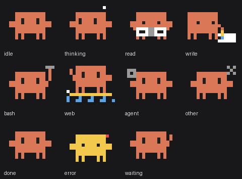

# clawd-mods

Claude Code が今なにをしているか（考え中・Read・Edit・Bash・Web・サブエージェント・許可待ち・完了・エラー）を、プロンプト上部の帯で Clawd のドットアニメとして表示する Claude Code Mod。任意で、BLE 経由で M5Stack Cardputer ADV の液晶にも同じアニメをミラーできる。



follow if you like : https://x.com/hawkieslab

## インストール

```
/plugin marketplace add hawkymisc/claude-plugins
/plugin install clawd-mods@hawkymisc-claude-plugins
```

Mac の帯表示だけならこれで完了。Cardputer にミラーしたい場合は下の「Cardputer ミラー（任意）」へ。

## 表示されるアニメ

| 状態 | きっかけ | アニメ |
|---|---|---|
| idle | セッション開始 | まばたき |
| thinking | プロンプト送信後・ツールの合間 | 左右に揺れて「…」 |
| read | Read / Grep / Glob / LS など | 本を読んでページをめくる |
| write | Edit / Write / NotebookEdit など | ペンで紙に字を書く |
| bash | Bash など | ハンマー |
| web | WebFetch / WebSearch | サーフボードで波乗り |
| agent | Agent / Task | 分身 |
| other | MCP ツールなどその他 | 歯車 |
| waiting | 許可ダイアログ表示中 | 手を振る |
| error | ツールがエラーを返した（1.5 秒） | しょんぼり（黄色＋赤い汗） |
| done | ターン完了（次のプロンプトまで維持） | ジャンプ |

- Desktop アプリでは SVG アニメ、ターミナルでは半角ブロック文字で描画する。
- サブエージェント内部のツール呼び出しは無視し、親の agent 表示を保つ。
- 各アニメの GIF は [`docs/anims/`](docs/anims) にある。

## コマンド

| コマンド | 動作 |
|---|---|
| `/clawd-mods demo` | 全 11 アニメを 3 秒ずつ帯で再生し、終わったら通常表示に戻る（Cardputer には送らない） |

## Cardputer ミラー（任意）

```
Claude Code (clawd-mods) ──Unix ソケット HTTP──▶ clawd-bridge (Mac 常駐) ──BLE──▶ Cardputer ADV
```

- 最大 3 セッションを横に並べて表示し、それ以上は `+N` 表示。
- bridge が動いていなくても Claude Code の動作は妨げない（帯に `Cardputer: 未接続` と出るだけ）。
- Mod から送るのはセッション ID・cwd のフォルダ名（12 文字まで）・状態・ツール名だけ。ファイルパスやコマンドは送らない。

マーケットプレイス経由のインストールに含まれるのは `mod/` だけなので、bridge と firmware はこのリポジトリを clone して使う。

```bash
git clone https://github.com/hawkymisc/claude-plugins.git
```

### 1. ファームウェアを書き込む

必要なもの: [arduino-cli](https://arduino.github.io/arduino-cli/)、ボードパッケージ `m5stack:esp32`（3.3.7 で確認）、ライブラリ `M5Cardputer`（1.1.1 で確認、M5Unified / M5GFX も入る）。

```bash
arduino-cli lib install M5Cardputer
```

```bash
arduino-cli compile --fqbn m5stack:esp32:m5stack_cardputer plugins/clawd-mods/firmware/clawd_cardputer
```

```bash
arduino-cli upload --fqbn m5stack:esp32:m5stack_cardputer -p <シリアルポート> plugins/clawd-mods/firmware/clawd_cardputer
```

起動すると `Clawd-Cardputer` として BLE アドバタイズし、Mac 接続待ちの間は「waiting for Mac...」と表示する。Claude が作業していない時にスペースキーを押すと、全アニメを順に再生する（再度押すと中断）。

### 2. bridge を常駐させる（macOS）

必要なもの: [uv](https://docs.astral.sh/uv/)、Python 3.12 以上、Xcode Command Line Tools（`cc` / `codesign`）。

```bash
plugins/clawd-mods/bridge/macos/install_agent.sh
```

`~/Applications/ClawdBridge.app` をビルドし、LaunchAgent `dev.clawd.bridge` としてログイン時に自動起動する。初回は Bluetooth の利用許可ダイアログが出るので許可する。

- ログ: `~/.clawd-bridge/bridge.log`
- 停止・削除: `install_agent.sh uninstall`（.app は残る）

> Claude Code の子プロセスから直接 Bluetooth を使うと macOS の権限（TCC）で落ちるため、.app ＋ LaunchAgent 経由で起動している。

### 3. 動作確認

```bash
cd plugins/clawd-mods/bridge && uv run python scripts/send_event.py status
```

`{"ble": "connected", ...}` なら接続済み。`send_event.py demo` で bridge 経由の全アニメを Cardputer に流せる。

## トラブルシューティング

| 症状 | 対処 |
|---|---|
| 帯に `Cardputer: 未接続` が出続ける | `send_event.py status` で bridge の応答と `ble` の値を確認。応答がなければ `install_agent.sh` を再実行 |
| `ble` が `scanning` のまま | Cardputer の電源・距離を確認。`uv run python scripts/scan.py`（Terminal.app から実行）で `Clawd-Cardputer` が見えるか確認 |
| ログに `CBErrorDomain Code=14` | 以前のファームのペアリング情報が残っている。システム設定 › Bluetooth で `Clawd-Cardputer` を登録解除する |

## 構成

| パス | 内容 |
|---|---|
| `mod/` | Claude Code Mod 本体（マーケットプレイスでインストールされる部分） |
| `bridge/` | 常駐デーモン（Python + bleak）。`macos/` に .app と LaunchAgent のスクリプト |
| `firmware/clawd_cardputer/` | Cardputer ADV 用 Arduino スケッチ |
| `sprites/` | 共通ドット定義。`gen.py` で `mod/hooks/sprites.ts` と `firmware/.../sprites.h` を生成、`export_gif.py` で GIF を出力 |
| `SPEC.md` | 状態遷移・IPC・BLE プロトコルなどの実装仕様 |

## 開発

```bash
claude plugin test plugins/clawd-mods/mod
```

```bash
cd plugins/clawd-mods/bridge && uv run pytest
```

```bash
cd plugins/clawd-mods/firmware/test && c++ -std=c++17 test_demo.cpp && ./a.out
```

スプライトを変更したら、`plugins/clawd-mods/` で `python3 sprites/gen.py mod/hooks/sprites.ts firmware/clawd_cardputer/sprites.h` を実行して両方を再生成する。
